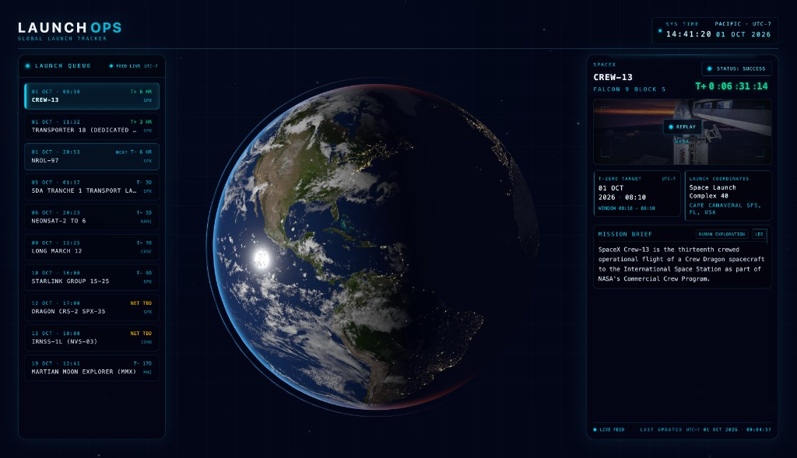

# LaunchOps

A real-time dashboard for tracking upcoming rocket launches.



LaunchOps combines launch schedules, mission details, local countdowns, and webcasts in a responsive mission-control interface. Data comes from [The Space Devs Launch Library](https://thespacedevs.com/), is cached through Redis and MongoDB, and reaches the browser through REST and Socket.IO.

## Highlights

- Live launch queue with sticky selection, local NET times, and honest TBD/TBC precision
- Mission, vehicle, provider, customer, orbit, launch site, and status details
- T− and T+ countdowns with launch-state-aware labels such as `LIVE`, `HOLD`, and `STREAM`
- Embedded YouTube webcasts, with outbound links for X and other providers
- Real-time cache updates over Socket.IO
- Solar-time Earth visualization with a day/night terminator
- Shared 12/24-hour clock preference and responsive layouts from phone to desktop

## How it works

```text
The Space Devs Launch Library
              |
              | detailed launches every 5 minutes
              v
         Ingestion worker
          /           \
   MongoDB             Redis cache
                          |
                    Redis Pub/Sub
                          |
                          v
                 Express + Socket.IO
                    /           \
             GET /launches   live-launch-data
                    \           /
                     React client
```

The backend starts the ingestion worker with the API server. The worker fetches upcoming launches, maps the external payload to LaunchOps' stored model, upserts MongoDB, refreshes Redis, and publishes an update. Clients initially hydrate through `GET /launches`; subsequent refreshes arrive over Socket.IO without reloading the page.

Webcast ranking stays in the frontend because availability can change with each feed refresh. LaunchOps prefers YouTube for in-app playback, then X, then other providers, while favoring live and official sources.

## Tech stack

- **Frontend:** React 19, Vite, Tailwind CSS 4, Framer Motion
- **Visualization:** three.js and React Three Fiber
- **Backend:** Node.js, Express 5, Socket.IO
- **Data:** MongoDB, Redis, The Space Devs Launch Library 2.3
- **Testing:** Vitest and Node's built-in test runner
- **Deployment:** Vercel frontend and Render backend

## Run locally

### Prerequisites

- Node.js 22+
- A MongoDB connection string
- A Redis connection URL

### 1. Clone and install

```bash
git clone https://github.com/brshin/launch-ops.git
cd launch-ops

cd backend && npm install
cd ../frontend && npm install
```

### 2. Configure the backend

Create `backend/.env`:

```env
MONGODB_URI=your_mongodb_connection_string
REDIS_URL=your_redis_url
FRONTEND_URL=http://localhost:5173
PORT=3000
```

### 3. Configure the frontend

Create `frontend/.env`:

```env
VITE_API_URL=http://localhost:3000
```

### 4. Start both services

In one terminal:

```bash
cd backend
node server.js
```

In another:

```bash
cd frontend
npm run dev -- --host
```

Open [http://localhost:5173](http://localhost:5173). The `--host` flag also makes the Vite preview available to devices on the same network.

## Development commands

Run tests:

```bash
cd frontend && npm test
cd backend && npm test
```

Lint or build the frontend:

```bash
cd frontend
npm run lint
npm run build
```

GitHub Actions runs both test suites for pull requests and pushes to `main`.

## Runtime contracts

### Environment variables

| Variable | Service | Purpose |
| --- | --- | --- |
| `MONGODB_URI` | Backend | MongoDB connection string |
| `REDIS_URL` | Backend | Redis cache and Pub/Sub connection |
| `FRONTEND_URL` | Backend | Allowed Socket.IO frontend origin; defaults to `*` |
| `PORT` | Backend | HTTP port; defaults to `3000` |
| `VITE_API_URL` | Frontend | REST and Socket.IO base URL; defaults to `http://localhost:3000` |

Local `.env` files are ignored by Git and should not be committed.

### HTTP and Socket.IO

| Contract | Purpose |
| --- | --- |
| `GET /` | Backend health response |
| `GET /launches` | Upcoming launches from Redis, falling back to MongoDB |
| `live-launch-data` | Server-to-client Socket.IO event after an ingestion refresh |

The worker requests:

```text
GET https://ll.thespacedevs.com/2.3.0/launches/upcoming/?mode=detailed
```

Detailed mode is required for webcast URLs. The worker runs once at startup and every five minutes thereafter.

## Repository layout

```text
launch-ops/
├── backend/                # Express API, ingestion worker, models, and tests
├── frontend/
│   ├── public/             # Static assets and Earth textures
│   └── src/
│       ├── components/     # Console, launch card, queue, and globe UI
│       ├── hooks/          # Feed, clock, countdown, and responsive state
│       ├── types/          # Frontend domain types
│       └── utils/          # Launch-domain helpers and contract tests
├── docs/                   # README imagery
└── .github/workflows/      # Continuous integration
```

## Data source

Launch data is provided by [The Space Devs](https://thespacedevs.com/). LaunchOps stores only the fields used by the application and treats provisional launch times as provisional rather than displaying false countdown precision.
