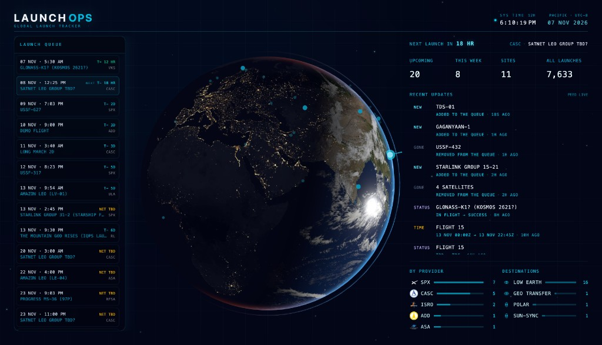

# LaunchOps

A real-time dashboard for tracking upcoming rocket launches.



LaunchOps combines launch schedules, mission details, local countdowns, webcasts, and a launch-site catalog in a responsive mission-control interface. Data comes from [The Space Devs Launch Library](https://thespacedevs.com/), is cached through Redis and MongoDB, and reaches the browser through REST and Socket.IO.

## Highlights

- Live launch queue with sticky selection, keyboard navigation, and honest TBD/TBC precision
- Mission card: vehicle, provider, customer, orbit, site, status, and T− / T+ countdowns
- Embedded YouTube webcasts, with outbound links for X and other providers
- Interactive day/night Earth — fly to pads, inspect catalog sites, drag-to-yaw with inertia
- Location inspector with imagery, lifetime metrics, and still-upcoming launches at that site
- Idle console overview with board stats and durable recent updates
- Real-time board refreshes over Socket.IO; shared 12/24-hour clock preference
- Shared signal colors — see [docs/color-scheme.md](docs/color-scheme.md)

## How it works

```text
The Space Devs Launch Library
        |                    |
        | upcoming           | locations catalog
        | every 5 minutes    | every 12 hours
        v                    v
           Ingestion worker
            /           \
     MongoDB             Redis cache
                            |
                      Redis Pub/Sub
                            |
                            v
                   Express + Socket.IO
                  /                  \
     GET /launches              GET /locations
     GET /launches/updates
     live-launch-data           live-location-data
     live-launch-events
                  \                  /
                     React client
```

The backend starts the ingestion worker with the API server. The worker maps Launch Library payloads into LaunchOps' stored model, upserts MongoDB, refreshes Redis, and publishes updates. Before overwriting the launches cache, it diffs the previous board, appends console events to a capped Redis list, and includes that batch in the pub/sub message. Clients hydrate through `GET /launches`, `GET /locations`, and `GET /launches/updates`; subsequent refreshes arrive over Socket.IO.

## Tech stack

- **Frontend:** React 19, Vite, Tailwind CSS 4, Framer Motion
- **Visualization:** three.js and React Three Fiber
- **Backend:** Node.js, Express 5, Socket.IO
- **Data:** MongoDB, Redis, The Space Devs Launch Library 2.3
- **Testing:** Vitest and Node's built-in test runner
- **Deployment:** Vercel frontend and Render backend

## Run locally

### Prerequisites

- Node.js 22+
- A MongoDB connection string
- A Redis connection URL

### 1. Clone and install

```bash
git clone https://github.com/brshin/launch-ops.git
cd launch-ops

cd backend && npm install
cd ../frontend && npm install
```

### 2. Configure the backend

Create `backend/.env`:

```env
MONGODB_URI=your_mongodb_connection_string
REDIS_URL=your_redis_url
FRONTEND_URL=http://localhost:5173
PORT=3000
```

### 3. Configure the frontend

Create `frontend/.env`:

```env
VITE_API_URL=http://localhost:3000
```

### 4. Start both services

In one terminal:

```bash
cd backend
node server.js
```

In another:

```bash
cd frontend
npm run dev -- --host
```

Open [http://localhost:5173](http://localhost:5173). The `--host` flag also makes the Vite preview available to devices on the same network.

## Development commands

```bash
cd frontend && npm test
cd backend && npm test

cd frontend
npm run lint
npm run build
```

GitHub Actions runs both test suites for pull requests and pushes to `main`.

## Runtime contracts

### Environment variables

| Variable | Service | Purpose |
| --- | --- | --- |
| `MONGODB_URI` | Backend | MongoDB connection string |
| `REDIS_URL` | Backend | Redis cache and Pub/Sub connection |
| `FRONTEND_URL` | Backend | Allowed Socket.IO frontend origin; defaults to `*` |
| `PORT` | Backend | HTTP port; defaults to `3000` |
| `VITE_API_URL` | Frontend | REST and Socket.IO base URL; defaults to `http://localhost:3000` |

Local `.env` files are ignored by Git and should not be committed.

### HTTP and Socket.IO

| Contract | Purpose |
| --- | --- |
| `GET /` | Backend health response |
| `GET /launches` | Upcoming launches from Redis, falling back to MongoDB |
| `GET /launches/updates` | Recent board change events (new / NET slip / status / webcast / removed), newest first |
| `GET /locations` | Launch-site catalog from Redis, falling back to MongoDB |
| `live-launch-data` | Socket.IO event after a launch ingestion refresh |
| `live-launch-events` | Socket.IO event with new board-change rows from that refresh |
| `live-location-data` | Socket.IO event after a locations ingestion refresh |

The worker requests:

```text
GET https://ll.thespacedevs.com/2.3.0/launches/upcoming/?mode=detailed&limit=20
GET https://ll.thespacedevs.com/2.3.0/locations/?format=json&limit=100
```

Detailed mode is required for webcast URLs. Launches refresh every five minutes (20 rows); locations paginate the full catalog about every twelve hours. Unauthenticated LL2 allows ~15 requests/hour per IP — this cadence stays under that without an API key.

## Repository layout

```text
launch-ops/
├── backend/                # Express API, ingestion worker, models, and tests
├── frontend/
│   ├── public/             # Static assets and Earth textures
│   └── src/
│       ├── components/     # Console, launch card, location panel, queue, and globe UI
│       ├── hooks/          # Launch/location feeds, clock, countdown, and responsive state
│       ├── lib/            # Motion tokens and shared signal colors
│       ├── types/          # Frontend domain types
│       └── utils/          # Launch/location helpers, globe focus, and contract tests
├── docs/                   # README imagery and color-scheme notes
└── .github/workflows/      # Continuous integration
```

## Data source

Launch and location data are provided by [The Space Devs](https://thespacedevs.com/). LaunchOps stores only the fields used by the application and treats provisional launch times as provisional rather than displaying false countdown precision.
